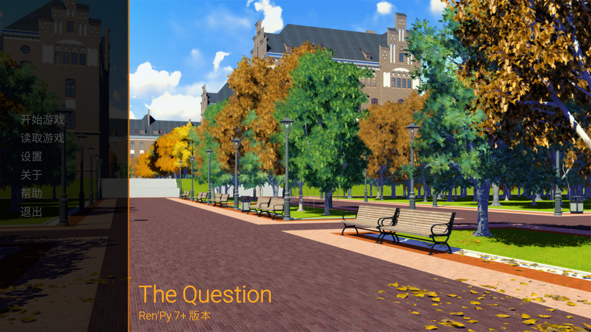
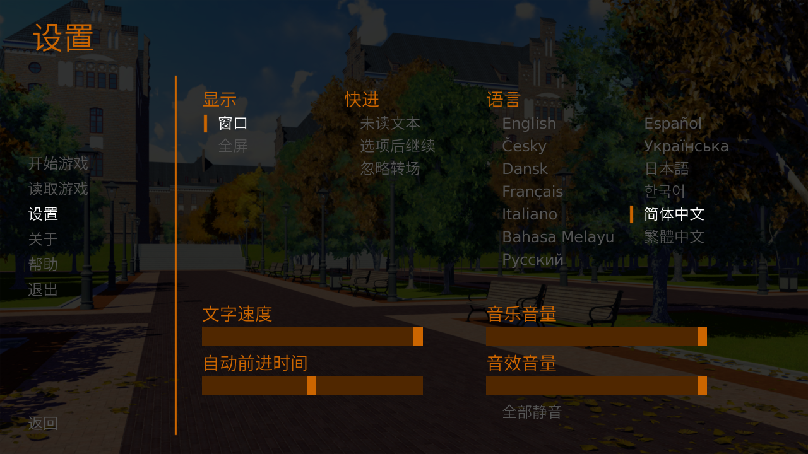
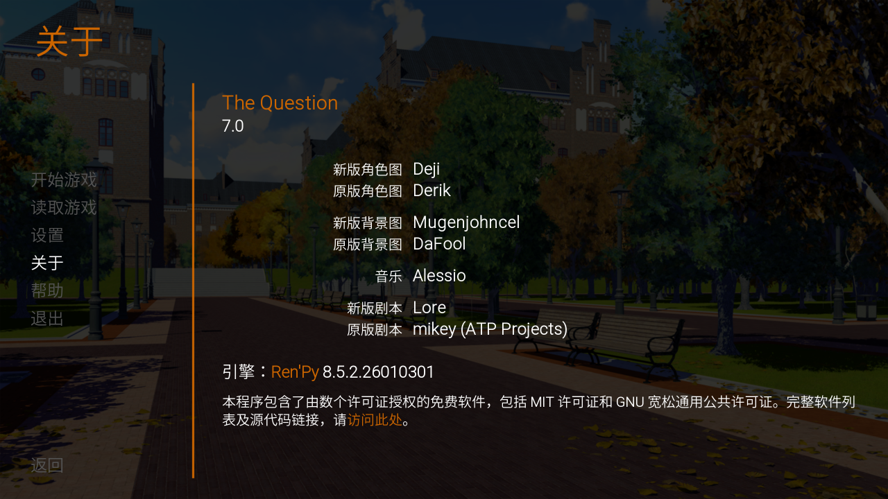
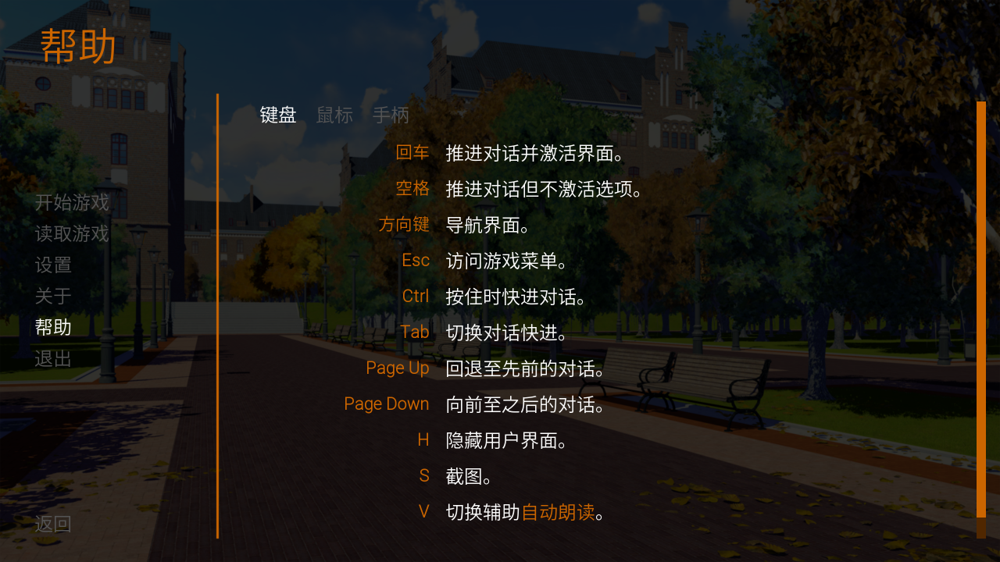
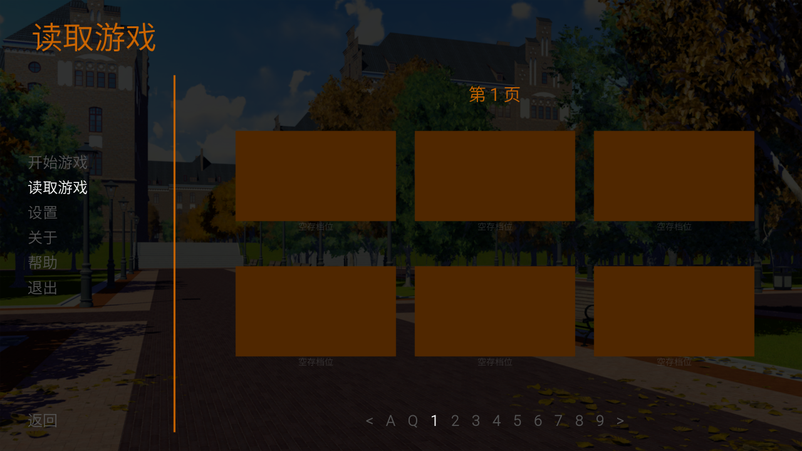
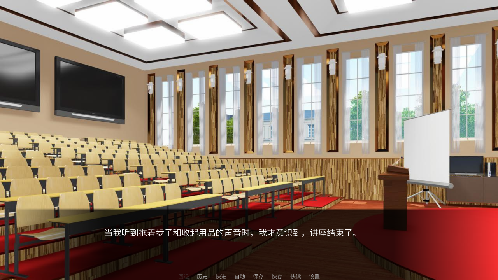
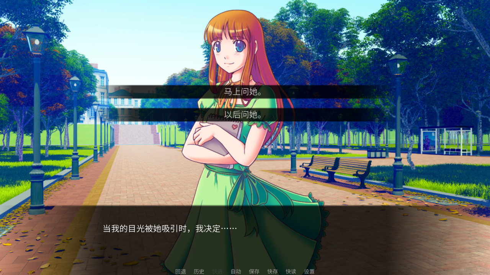
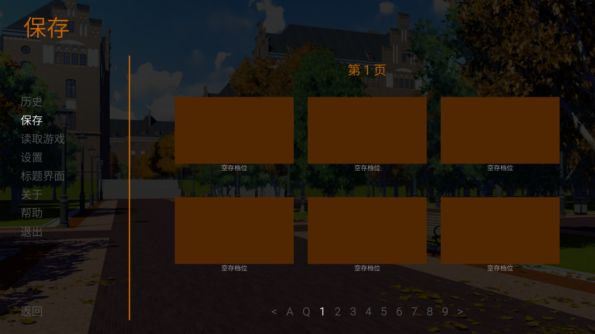
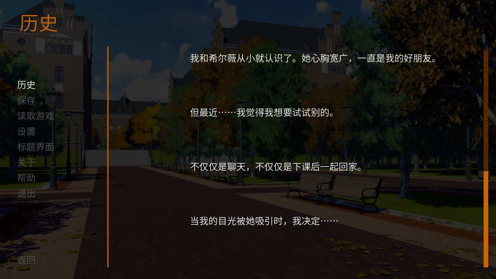
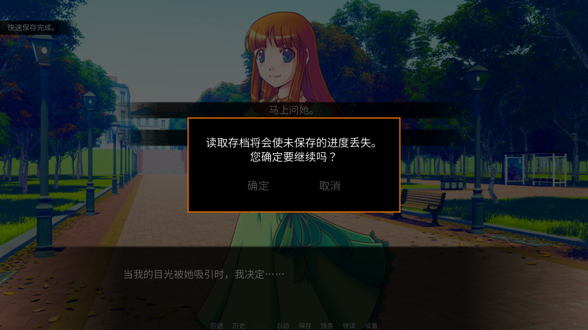

# The Question → NarraLeaf 迁移补充包

这份文件由 Ren2Leaf 生成。迁移者把它导入 NarraLeaf Studio 的 Ren2Leaf Bridge 插件，Agent 通过插件的工具读它；
Ren'Py 游戏源码另外交给 Agent。它记录原作里有什么、迁移者定了什么，是源码里看不出来、或者要人来定的那部分。

## 0　硬性要求

1. 这份补充包只通过 Ren2Leaf Bridge 读，不要另找补充包文件夹：

   - `pack_section` 读本文的一节；
   - `pack_query` 查完整扫描结果，文中写「其余见 `data/inventory.json`」的长表从这里查；
   - `pack_screen` 读一张截图的元素坐标，`pack_image` 看文中引用的图片（截图、切图、角色图）。

   迁移方法见 Ren'Py 移植 skill `narraleaf-port-renpy`（Ren2Leaf 仓库 `skills/narraleaf-port-renpy/`），
   它建立在 NarraLeaf Skills（`npx skills add NarraLeaf/Skills -g`）之上。两者有一个没装，先请迁移者装好再动手。

2. **这份文件是路牌，不是方案。** 它只说明原作的事实和迁移者的决定；具体怎么迁移由你判断，
   不要被本文的措辞带着走。文中出现的任何 NarraLeaf 写法都只是参考，以 skill 和 Studio 的
   `story_command` 目录为准。

3. 角色一节只说明**迁移者的分组意图**；是否创建角色、怎么创建，由你决定。

4. 迁移者明确保证过的事（哪个文件属于哪一章之类）照做，其余都是线索。

5. 每张表都标了这一列是谁说的：**迁移者**（人确认过）、**扫描**（静态读出来的事实）、
   **引擎**（截图时从运行中的游戏取的）。三者冲突时，以源码为准。

## 1　这份文件说了什么

| 节 | 内容 |
| --- | --- |
| 2 | 游戏规格：分辨率、引擎版本、源码完整度 |
| 3 | 说话人：每个 Character 变量的证据，和迁移者的分类 |
| 4 | Python 逻辑：每一处 `$`、python 块、非字面量的 define/default |
| 5 | 流程与章节：迁移者定的章节分组，以及 label 图、菜单、结局 |
| 6 | 界面截图：游戏实际跑出来的画面和元素坐标 |
| 7 | 文本与演出：文字标签、插值、转场、transform、成就、persistent |
| 8 | 资产：引用不到的文件、格式不符、重复素材、要离线处理的素材 |
| 9 | 静态扫描确定不了的，以及本工具没有检查的 |
| 10 | 这份包里的文件 |

本文件里所有 `文件:行号` 都相对游戏的 `game/` 目录。

## 2　游戏概况

| 项 | 值 |
| --- | --- |
| 游戏名 | The Question |
| 版本 | 7.0 |
| 分辨率 | 1280×720（16:9） |
| 引擎版本 | 未知 |
| 建议 SDK | Ren'Py 8（把握：medium） |
| 源码状态 | 源码完整 |
| 脚本文件 | .rpy 52，.py 0，.rpyc 53，.rpa 0 |
| 扫描时间 | 2026-10-27T10:52:08.677Z |
| 扫描器版本 | ren2leaf-diagnose 0.3.0（inventory v2） |
| 源码指纹 | sha256:585e2393d74bd507（53 个脚本，747 KB） |

源码指纹是生成这份包时 `game/` 下所有 `.rpy`/`.rpym`/`.py` 的内容摘要。手上的源码和它对不上，说明这份包和源码不是同一个版本。

## 3　说话人

共 2 个 Character 变量，2 个有台词；台词 40 句，旁白 31 句，带配音 0 句。

迁移者把每个变量分成了四类，意思如下：

| 类别 | 迁移者的意思 | 在 Studio 里怎么落地 |
| --- | --- | --- |
| 主要角色 | 主角，直接列在角色面板里 | `character_upsert` 建角色，**不带 `group`**；有立绘的配立绘（分层立绘用 `character_layered_set`） |
| POV 角色 | 主角，玩家视角 | 同上，也不带 `group`；名字框随章节变的，按原作每段的名字写 |
| NPC / 别名 | 次要角色，收进一个分组 | `character_upsert` 建角色，带 `group: "NPC / 别名"`，名字按下表 |
| 临时角色 | 迁移者认为不需要独立角色（无立绘无配音的过场人物） | 不建角色，台词写成一次性说话人 |

Studio 的角色面板按分组列角色，`character_upsert` 的 `group` 按名字归组，组不存在就新建；不带 `group` 时角色**留在原来的组**，传 `group: null` 才把它拿出来，直接列在面板上。迁移者定的是：**主要角色和 POV 角色都不分组**，直接列在外面；只有「NPC / 别名」这一类收进同名分组。不要给主角另建「主角」之类的组；复用的骨架示例角色要是已经在某个组里，建的时候传 `group: null`。「NPC / 别名」的角色照建，只是不必像主角那样准备立绘和差分。

### 3.1　主要角色

| 角色 | 变量 | 原显示名 | 台词 | 合并进来的变量 | 立绘 | POV | 备注 |
| --- | --- | --- | --- | --- | --- | --- | --- |
| Sylvie | s | Sylvie | 18 | — |  |  | 女主角，全篇唯一有立绘的角色，立绘 tag 为 sylvie |
| Me | m | Me | 22 | — | — | 是 | 玩家视角的叙述者，原作未给专名，名字框固定显示 Me |

POV 角色是玩家的视角（Me）；原作的名字框可能随章节变。

## 4　Python 逻辑

共 90 条。其中字面量赋值 1 条，映射表里有的 API 0 处，没有现成对应的 4 条，静态确定不了的 0 条，界面与选项配置 81 条，函数或类内部的名字 0 条。

只有 label 里的 `$` 行、顶层 python 块和 `default`/`define` 会动到故事状态。函数体和类体里的名字是局部的，下面按函数折叠，不按行列。

### 4.1　字面量赋值

值是字面量，没有表达式。

| 位置 | label | 原文 | 映射表里的写法 |
| --- | --- | --- | --- |
| script.rpy:135 | book | book = True | /set book true |

### 4.2　映射表里没有现成对应的

| 位置 | label | 原文 | 映射表里的写法 | 扫描看到的 |
| --- | --- | --- | --- | --- |
| gui.rpy:415 | — | def touch(): | /blueprint | 自定义函数 |
| gui.rpy:422 | — | def small(): | /blueprint | 自定义函数 |
| testcases.rpy:3 | — | _test.transition_timeout = 0.05 | — | 赋值目标是属性或下标 |
| testcases.rpy:4 | — | _test.timeout = 2.0 | — | 赋值目标是属性或下标 |

### 4.3　游戏自己的函数

「包的是」一列是函数体里唯一那个已知 API：这种函数的每一处调用，和直接调用那个 API 是一回事。

| 函数 | 定义 | 调用次数 | 函数体行数 | 包的是 | 体内用到的 API |
| --- | --- | --- | --- | --- | --- |
| touch | gui.rpy:415 | 0 | 1 | — | — |
| small | gui.rpy:422 | 0 | 28 | — | — |

### 4.4　变量

原作用 `default` 声明的是会变的量，`define` 的多半是常量。不在这张表里的：角色、位置、转场这类 `define`（值是 `Character(…)`、`Transform(…)` 之类）；值是素材路径的 `define`（在第 8 节）；只有界面读写的名字（下面单列）。

| 变量 | 来自 | 首次出现 | 写入次数 |
| --- | --- | --- | --- |
| book | default | script.rpy:7 | 1 |
| quick_menu | default | screens.rpy:262 | 0 |

从这张表里剔掉的 2 个名字（它们是角色、图像或转场的定义）：`m`（Character）、`s`（Character）

## 5　流程与章节

Studio 的层级是**故事 → 章节 → 场景**，整部游戏是**一个**故事：不要为每个文件各建一个故事——存读档和「继续游戏」都认故事，拆开会出问题。

**迁移者在这里分的「章节」，在 Studio 里是场景**：下表一行做成一个场景（`scene_create {name}`），这一行的文件按顺序写进这一个场景，文件里的 label 不再各自成场景。场景都放进故事已有的那一章，不要自己起 Studio 的章节名。

场景名和描述是迁移者的话，照抄，不改写：

- 场景名：「标题」一列。迁移者没填的，用 Studio 默认的场景名 `New Scene`，不要按内容自己起名；有几个都叫 `New Scene` 时，之后按 `scene_create` 返回的 id 指认场景，不靠名字。

- 每个场景的表头（`story_apply` 的 `#background` 和 `#description`，写法看 NarraLeaf Studio 的 Skill）：

  - `#background` **每个场景都要写**：原作这一段开场时屏幕上的背景，一般是第一句 `scene` 的图；开场是黑屏或纯色就写 `#background none`。不写的话，复用骨架的示例场景会闪出示例图。

  - `#description` **只写迁移者填的「描述」**，原样照抄。没填就不写这一行，不要自己总结剧情补上。

下面是迁移者定的分组。

**拆分方式：按选项拆分。** 迁移者的意思是：选项（menu）引出的支线各自成为独立的场景，主线留在这一章做成的场景里。支线场景迁移者没有起名，用原作 label 的名字，不写描述。

### 5.1　章节与文件

| 章节 | 标题（场景名） | 描述（场景描述） | 文件 | 台词 | 备注 |
| --- | --- | --- | --- | --- | --- |
| 1 | 第一章 | （没填，不写） | script.rpy | 71 |  |

⚠️ **一个文件只属于一个章节，而且文件里不会跨到别的章节**——这是迁移者保证的，扫描查不了。

### 5.2　每个文件里有什么

「游玩顺序」是从 `start` 走出来的先后，不是文件名的顺序。被 `persistent.*` 条件挡住的路线（二周目之类）排在一周目路线之后，并在「周目」一列标出来。迁移者排除的文件不在这张表里。

| 文件 | 游玩顺序 | 周目 | 台词 | label | 菜单 | label 名 |
| --- | --- | --- | --- | --- | --- | --- |
| script.rpy | 1 |  | 71 | 6 | 2 | start、rightaway、game、book… |

### 5.3　流程事实

6 个 label，可达 6 个，走不到 0 个；菜单 2 个（4 个选项），结局 2 个。

- 文件顺序与执行顺序从第 4 个 label 起产生分歧（按文件为 book，按执行为 marry）
- 章节划分由迁移者决定：扫描仅提供每个文件的台词数、label 及疑似分界信号（黑场、停止音乐、过场视频、成就点）

#### 菜单与选项

「选项里写了什么」是选中之后、走出这个选项之前的赋值：路线常常就是这样分开的，所以没有跳转的选项不等于什么都没做。

| 菜单 | 所属 label | 选项 | 条件 | 选项里写了什么 | 去向 |
| --- | --- | --- | --- | --- | --- |
| script.rpy:40 | start | To ask her right away. | — | — | rightaway |
| script.rpy:40 | start | To ask her later. | — | — | later |
| script.rpy:97 | rightaway | It's a videogame. | — | — | game |
| script.rpy:97 | rightaway | It's an interactive book. | — | — | book |

#### 结局

路线在这里走完：要么以 `return` 收尾（而且不是被 `call` 进来的子流程），要么跳回标题画面。

| label | 位置 | 台词 | 周目 | 判断 |
| --- | --- | --- | --- | --- |
| marry | script.rpy:236 | 24 |  | 以 return 收尾 |
| later | script.rpy:252 | 5 |  | 以 return 收尾 |

## 6　界面截图

迁移者一边玩一边截的**游戏实际画面**，元素坐标来自引擎，不是从代码推的。坐标是 `x, y, 宽, 高`，按截图分辨率。字号、颜色、描边、对齐不在截图数据里，要自己读 `screens.rpy` 和 gui 变量。

| 截图 | 对应界面 | 图 | 元素 | 说明 |
| --- | --- | --- | --- | --- |
| 主界面 | main_menu | [screens/shot-20261019-230815.png](screens/shot-20261019-230815.png) | 21 | 迁移者标注：主界面 |
| 设置 | preferences | [screens/shot-20261019-230823.png](screens/shot-20261019-230823.png) | 96 | 迁移者标注：设置 |
| 关于 | about | [screens/shot-20261019-230827.png](screens/shot-20261019-230827.png) | 48 | 迁移者标注：关于 |
| 帮助 | help | [screens/shot-20261019-230832.png](screens/shot-20261019-230832.png) | 75 | 迁移者标注：帮助 |
| 读取游戏 | load | [screens/shot-20261019-230839.png](screens/shot-20261019-230839.png) | 70 | 迁移者标注：读取游戏 |
| 游戏界面 | say、quick_menu | [screens/shot-20261019-230846.png](screens/shot-20261019-230846.png) | 24 | 迁移者标注：游戏界面 |
| 选项 | say、choice、quick_menu | [screens/shot-20261019-230922.png](screens/shot-20261019-230922.png) | 31 | 迁移者标注：选项 |
| 保存 | save | [screens/shot-20261019-231540.png](screens/shot-20261019-231540.png) | 74 | 迁移者标注：保存 |
| 历史 | history | [screens/shot-20261019-231550.png](screens/shot-20261019-231550.png) | 45 | 迁移者标注：历史 |
| 对话框 | say、choice、quick_menu、notify、confirm | [screens/shot-20261019-231605.png](screens/shot-20261019-231605.png) | 44 | 迁移者标注：对话框 |

源码里定义的界面，哪些有截图：

| 界面 | 来自 | 有截图 | 界面里的 action |
| --- | --- | --- | --- |
| file_slots | 标准 | 没有 | FileAction×1、FileDelete×1、FilePage×3、FilePageNext×2、FilePagePrevious×2、page_name_value.Toggle×1 |
| game_menu | 标准 | 没有 | Return×1、ShowMenu×1 |
| gamepad_help | 标准 | 没有 | GamepadCalibrate×1 |
| input | 标准 | 没有 | — |
| keyboard_help | 标准 | 没有 | — |
| mouse_help | 标准 | 没有 | — |
| navigation | 标准 | 没有 | EndReplay×1、MainMenu×1、Quit×1、ShowMenu×6、Start×1 |
| nvl | 标准 | 没有 | (expression)×1 |
| nvl_dialogue | 标准 | 没有 | — |
| skip_indicator | 标准 | 没有 | — |
| about | 标准 | 有 | — |
| choice | 标准 | 有 | (expression)×1 |
| confirm | 标准 | 有 | (variable)×3 |
| help | 标准 | 有 | SetScreenVariable×3 |
| history | 标准 | 有 | — |
| load | 标准 | 有 | — |
| main_menu | 标准 | 有 | — |
| notify | 标准 | 有 | Hide×1 |
| preferences | 标准 | 有 | InvertSelected×1、Language×13、Play×2、Preference×5 |
| quick_menu | 标准 | 有 | Preference×2、QuickLoad×1、QuickSave×1、Rollback×2、ShowMenu×4、Skip×4 |
| save | 标准 | 有 | — |
| say | 标准 | 有 | — |

### 6.1　主界面

迁移者标注：主界面

| 项 | 值 |
| --- | --- |
| 界面 | main_menu |
| 分辨率 | 1280×720 |
| 来源 | renpy/common/_layout/screen_main_menu.rpym:28 |

| 元素 | 位置 x, y, w, h | 文字 | 图片 | 其它状态的图 | 定义处 |
| --- | --- | --- | --- | --- | --- |
| Button | 40, 242, 104, 36 | 开始游戏 | gui/button/idle_background.png | — | game/screens.rpy:295 |
| Text | 44, 244, 96, 31 | 开始游戏 | — | — | game/screens.rpy:295 |
| Button | 40, 282, 104, 36 | 读取游戏 | gui/button/idle_background.png | — | game/screens.rpy:303 |
| Text | 44, 284, 96, 31 | 读取游戏 | — | — | game/screens.rpy:303 |
| Button | 40, 322, 104, 36 | 设置 | gui/button/idle_background.png | — | game/screens.rpy:305 |
| Text | 44, 324, 48, 31 | 设置 | — | — | game/screens.rpy:305 |
| Button | 40, 362, 104, 36 | 关于 | gui/button/idle_background.png | — | game/screens.rpy:315 |
| Text | 44, 364, 48, 31 | 关于 | — | — | game/screens.rpy:315 |
| Button | 40, 402, 104, 36 | 帮助 | gui/button/idle_background.png | — | game/screens.rpy:320 |
| Text | 44, 404, 48, 31 | 帮助 | — | — | game/screens.rpy:320 |
| Button | 40, 442, 104, 36 | 退出 | gui/button/idle_background.png | — | game/screens.rpy:325 |
| Text | 44, 444, 48, 31 | 退出 | — | — | game/screens.rpy:325 |
| Text | 300, 607, 290, 62 | The Question | — | — | game/screens.rpy:365 |
| Text | 300, 669, 157, 31 | Ren'Py 7+ 版本 | — | — | game/screens.rpy:368 |

### 6.2　设置

迁移者标注：设置

| 项 | 值 |
| --- | --- |
| 界面 | preferences |
| 分辨率 | 1280×720 |
| 来源 | renpy/common/_layout/screen_main_menu.rpym:28 |

| 元素 | 位置 x, y, w, h | 文字 | 图片 | 其它状态的图 | 定义处 |
| --- | --- | --- | --- | --- | --- |
| Text | 320, 140, 56, 36 | 显示 | — | — | game/screens.rpy:772 |
| Button | 320, 178, 77, 36 | 窗口 | gui/button/idle_background.png | — | game/screens.rpy:773 |
| Text | 345, 180, 48, 31 | 窗口 | — | — | game/screens.rpy:773 |
| Button | 320, 214, 77, 36 | 全屏 | gui/button/idle_background.png | — | game/screens.rpy:774 |
| Text | 345, 216, 48, 31 | 全屏 | — | — | game/screens.rpy:774 |
| Text | 545, 140, 56, 36 | 快进 | — | — | game/screens.rpy:778 |
| Button | 545, 178, 125, 36 | 未读文本 | gui/button/idle_background.png | — | game/screens.rpy:779 |
| Text | 570, 180, 96, 31 | 未读文本 | — | — | game/screens.rpy:779 |
| Button | 545, 214, 149, 36 | 选项后继续 | gui/button/idle_background.png | — | game/screens.rpy:780 |
| Text | 570, 216, 120, 31 | 选项后继续 | — | — | game/screens.rpy:780 |
| Button | 545, 250, 125, 36 | 忽略转场 | gui/button/idle_background.png | — | game/screens.rpy:781 |
| Text | 570, 252, 96, 31 | 忽略转场 | — | — | game/screens.rpy:781 |
| Text | 770, 140, 56, 36 | 语言 | — | — | game/screens.rpy:790 |
| Button | 770, 178, 115, 36 | English | gui/button/idle_background.png | — | game/screens.rpy:792 |
| Text | 795, 181, 86, 29 | English | — | — | game/screens.rpy:792 |
| Button | 770, 214, 100, 36 | Česky | gui/button/idle_background.png | — | game/screens.rpy:793 |
| Text | 795, 217, 71, 29 | Česky | — | — | game/screens.rpy:793 |
| Button | 770, 250, 102, 36 | Dansk | gui/button/idle_background.png | — | game/screens.rpy:794 |
| Text | 795, 253, 73, 29 | Dansk | — | — | game/screens.rpy:794 |
| Button | 770, 286, 126, 36 | Français | gui/button/idle_background.png | — | game/screens.rpy:795 |
| Text | 795, 289, 97, 29 | Français | — | — | game/screens.rpy:795 |
| Button | 770, 322, 117, 36 | Italiano | gui/button/idle_background.png | — | game/screens.rpy:796 |
| Text | 795, 325, 88, 29 | Italiano | — | — | game/screens.rpy:796 |
| Button | 770, 358, 207, 36 | Bahasa Melayu | gui/button/idle_background.png | — | game/screens.rpy:797 |
| Text | 795, 361, 178, 29 | Bahasa Melayu | — | — | game/screens.rpy:797 |
| Button | 770, 394, 127, 36 | Русский | gui/button/idle_background.png | — | game/screens.rpy:798 |
| Text | 795, 397, 98, 29 | Русский | — | — | game/screens.rpy:798 |
| Text | 995, 140, 6, 36 |   | — | — | game/screens.rpy:802 |
| Button | 995, 178, 121, 36 | Español | gui/button/idle_background.png | — | game/screens.rpy:804 |
| Text | 1020, 181, 92, 29 | Español | — | — | game/screens.rpy:804 |

### 6.3　关于

迁移者标注：关于

| 项 | 值 |
| --- | --- |
| 界面 | about |
| 分辨率 | 1280×720 |
| 来源 | renpy/common/_layout/screen_main_menu.rpym:28 |

| 元素 | 位置 x, y, w, h | 文字 | 图片 | 其它状态的图 | 定义处 |
| --- | --- | --- | --- | --- | --- |
| Text | 320, 130, 168, 36 | The Question | — | — | game/screens.rpy:548 |
| Text | 320, 166, 31, 62 | 7.0  | — | — | game/screens.rpy:549 |
| Text | 320, 232, 260, 26 | 新版角色图 | — | — | game/screens.rpy:553 |
| Text | 595, 228, 40, 31 | Deji | — | — | game/screens.rpy:554 |
| Text | 320, 263, 260, 26 | 原版角色图 | — | — | game/screens.rpy:558 |
| Text | 595, 259, 55, 31 | Derik | — | — | game/screens.rpy:559 |
| Text | 320, 309, 260, 26 | 新版背景图 | — | — | game/screens.rpy:565 |
| Text | 595, 305, 155, 31 | Mugenjohncel | — | — | game/screens.rpy:566 |
| Text | 320, 340, 260, 26 | 原版背景图 | — | — | game/screens.rpy:570 |
| Text | 595, 336, 77, 31 | DaFool | — | — | game/screens.rpy:571 |
| Text | 320, 386, 260, 26 | 音乐 | — | — | game/screens.rpy:577 |
| Text | 595, 382, 77, 31 | Alessio | — | — | game/screens.rpy:578 |
| Text | 320, 432, 260, 26 | 新版剧本 | — | — | game/screens.rpy:584 |
| Text | 595, 428, 49, 31 | Lore | — | — | game/screens.rpy:585 |
| Text | 320, 463, 260, 26 | 原版剧本 | — | — | game/screens.rpy:589 |
| Text | 595, 459, 224, 31 | mikey (ATP Projects) | — | — | game/screens.rpy:590 |
| Text | 390.5, 521, 69.5, 31 |  引擎：{a=https://www.renpy.org/}Ren'Py{/a} 8.5.2.26010301 | — | — | game/screens.rpy:593 |
| Text | 500, 593, 80, 26 | 本程序包含了由数个许可证授权的免费软件，包括 MIT 许可证和 GNU 宽松通用公共许可证。完整软件列表及源代码链接，请{a=https://www.renpy.org/l/license}访问此处{/a}。 | — | — | game/screens.rpy:595 |
| Bar | 1250, 130, 12, 560 | — | — | — | — |
| Button | 40, 242, 104, 36 | 开始游戏 | gui/button/idle_background.png | — | game/screens.rpy:295 |
| Text | 44, 244, 96, 31 | 开始游戏 | — | — | game/screens.rpy:295 |
| Button | 40, 282, 104, 36 | 读取游戏 | gui/button/idle_background.png | — | game/screens.rpy:303 |
| Text | 44, 284, 96, 31 | 读取游戏 | — | — | game/screens.rpy:303 |
| Button | 40, 322, 104, 36 | 设置 | gui/button/idle_background.png | — | game/screens.rpy:305 |
| Text | 44, 324, 48, 31 | 设置 | — | — | game/screens.rpy:305 |
| Button | 40, 362, 104, 36 | 关于 | gui/button/idle_background.png | — | game/screens.rpy:315 |
| Text | 44, 364, 48, 31 | 关于 | — | — | game/screens.rpy:315 |
| Button | 40, 402, 104, 36 | 帮助 | gui/button/idle_background.png | — | game/screens.rpy:320 |
| Text | 44, 404, 48, 31 | 帮助 | — | — | game/screens.rpy:320 |
| Button | 40, 442, 104, 36 | 退出 | gui/button/idle_background.png | — | game/screens.rpy:325 |

### 6.4　帮助

迁移者标注：帮助

| 项 | 值 |
| --- | --- |
| 界面 | help |
| 分辨率 | 1280×720 |
| 来源 | renpy/common/_layout/screen_main_menu.rpym:28 |

| 元素 | 位置 x, y, w, h | 文字 | 图片 | 其它状态的图 | 定义处 |
| --- | --- | --- | --- | --- | --- |
| Button | 328, 130, 64, 36 | 键盘 | gui/button/idle_background.png | — | game/screens.rpy:1045 |
| Text | 332, 132, 48, 31 | 键盘 | — | — | game/screens.rpy:1045 |
| Button | 400, 130, 64, 36 | 鼠标 | gui/button/idle_background.png | — | game/screens.rpy:1046 |
| Text | 404, 132, 48, 31 | 鼠标 | — | — | game/screens.rpy:1046 |
| Button | 472, 130, 64, 36 | 手柄 | gui/button/idle_background.png | — | game/screens.rpy:1049 |
| Text | 476, 132, 48, 31 | 手柄 | — | — | game/screens.rpy:1049 |
| Text | 506, 181, 44, 28 | 回车 | — | — | game/screens.rpy:1062 |
| Text | 570, 181, 240, 31 | 推进对话并激活界面。 | — | — | game/screens.rpy:1063 |
| Text | 506, 227, 44, 28 | 空格 | — | — | game/screens.rpy:1066 |
| Text | 570, 227, 264, 31 | 推进对话但不激活选项。 | — | — | game/screens.rpy:1067 |
| Text | 484, 273, 66, 28 | 方向键 | — | — | game/screens.rpy:1070 |
| Text | 570, 273, 120, 31 | 导航界面。 | — | — | game/screens.rpy:1071 |
| Text | 514, 319, 36, 28 | Esc | — | — | game/screens.rpy:1074 |
| Text | 570, 319, 168, 31 | 访问游戏菜单。 | — | — | game/screens.rpy:1075 |
| Text | 515, 365, 35, 28 | Ctrl | — | — | game/screens.rpy:1078 |
| Text | 570, 365, 192, 31 | 按住时快进对话。 | — | — | game/screens.rpy:1079 |
| Text | 512, 411, 38, 28 | Tab | — | — | game/screens.rpy:1082 |
| Text | 570, 411, 168, 31 | 切换对话快进。 | — | — | game/screens.rpy:1083 |
| Text | 468, 457, 82, 28 | Page Up | — | — | game/screens.rpy:1086 |
| Text | 570, 457, 216, 31 | 回退至先前的对话。 | — | — | game/screens.rpy:1087 |
| Text | 440, 503, 110, 28 | Page Down | — | — | game/screens.rpy:1090 |
| Text | 570, 503, 216, 31 | 向前至之后的对话。 | — | — | game/screens.rpy:1091 |
| Text | 534, 549, 16, 28 | H | — | — | game/screens.rpy:1094 |
| Text | 570, 549, 168, 31 | 隐藏用户界面。 | — | — | game/screens.rpy:1095 |
| Text | 537, 595, 13, 28 | S | — | — | game/screens.rpy:1098 |
| Text | 570, 595, 72, 31 | 截图。 | — | — | game/screens.rpy:1099 |
| Text | 536, 641, 14, 28 | V | — | — | game/screens.rpy:1102 |
| Text | 666, 641, 96, 31 | 切换辅助{a=https://www.renpy.org/l/voicing}自动朗读{/a}。 | — | — | game/screens.rpy:1103 |
| Text | 478, 687, 72, 28 | Shift+A | — | — | game/screens.rpy:1106 |
| Text | 570, 687, 670, 3 | Opens the accessibility menu. | — | — | game/screens.rpy:1107 |

### 6.5　读取游戏

迁移者标注：读取游戏

| 项 | 值 |
| --- | --- |
| 界面 | load |
| 分辨率 | 1280×720 |
| 来源 | renpy/common/_layout/screen_main_menu.rpym:28 |

| 元素 | 位置 x, y, w, h | 文字 | 图片 | 其它状态的图 | 定义处 |
| --- | --- | --- | --- | --- | --- |
| Button | 574, 654, 32, 36 | < | gui/button/idle_background.png | — | game/screens.rpy:696 |
| Text | 584, 656, 12, 31 | < | — | — | game/screens.rpy:696 |
| Button | 606, 654, 35, 36 | {#auto_page}A | gui/button/idle_background.png | — | game/screens.rpy:700 |
| Text | 616, 656, 15, 31 | {#auto_page}A | — | — | game/screens.rpy:700 |
| Button | 641, 654, 36, 36 | {#quick_page}Q | gui/button/idle_background.png | — | game/screens.rpy:703 |
| Text | 651, 656, 16, 31 | {#quick_page}Q | — | — | game/screens.rpy:703 |
| Button | 677, 654, 33, 36 | 1 | gui/button/idle_background.png | — | game/screens.rpy:707 |
| Text | 687, 656, 13, 31 | 1 | — | — | game/screens.rpy:707 |
| Button | 710, 654, 33, 36 | 2 | gui/button/idle_background.png | — | game/screens.rpy:707 |
| Text | 720, 656, 13, 31 | 2 | — | — | game/screens.rpy:707 |
| Button | 743, 654, 33, 36 | 3 | gui/button/idle_background.png | — | game/screens.rpy:707 |
| Text | 753, 656, 13, 31 | 3 | — | — | game/screens.rpy:707 |
| Button | 776, 654, 33, 36 | 4 | gui/button/idle_background.png | — | game/screens.rpy:707 |
| Text | 786, 656, 13, 31 | 4 | — | — | game/screens.rpy:707 |
| Button | 809, 654, 33, 36 | 5 | gui/button/idle_background.png | — | game/screens.rpy:707 |
| Text | 819, 656, 13, 31 | 5 | — | — | game/screens.rpy:707 |
| Button | 842, 654, 33, 36 | 6 | gui/button/idle_background.png | — | game/screens.rpy:707 |
| Text | 852, 656, 13, 31 | 6 | — | — | game/screens.rpy:707 |
| Button | 875, 654, 33, 36 | 7 | gui/button/idle_background.png | — | game/screens.rpy:707 |
| Text | 885, 656, 13, 31 | 7 | — | — | game/screens.rpy:707 |
| Button | 908, 654, 33, 36 | 8 | gui/button/idle_background.png | — | game/screens.rpy:707 |
| Text | 918, 656, 13, 31 | 8 | — | — | game/screens.rpy:707 |
| Button | 941, 654, 33, 36 | 9 | gui/button/idle_background.png | — | game/screens.rpy:707 |
| Text | 951, 656, 13, 31 | 9 | — | — | game/screens.rpy:707 |
| Button | 974, 654, 32, 36 | > | gui/button/idle_background.png | — | game/screens.rpy:709 |
| Text | 984, 656, 12, 31 | > | — | — | game/screens.rpy:709 |
| Button | 366, 199, 276, 206 | 空存档位 | gui/button/slot_idle_background.png | — | game/screens.rpy:672 |
| Text | 476, 353, 56, 18 | 空存档位 | — | — | game/screens.rpy:679 |
| Button | 652, 199, 276, 206 | 空存档位 | gui/button/slot_idle_background.png | — | game/screens.rpy:672 |
| Text | 762, 353, 56, 18 | 空存档位 | — | — | game/screens.rpy:679 |

### 6.6　游戏界面

迁移者标注：游戏界面

| 项 | 值 |
| --- | --- |
| 界面 | say、quick_menu |
| 分辨率 | 1280×720 |
| 来源 | game/tl/schinese/script.rpy:6 |

| 元素 | 位置 x, y, w, h | 文字 | 图片 | 其它状态的图 | 定义处 |
| --- | --- | --- | --- | --- | --- |
| Text | 268, 585, 660, 28 | 当我听到拖着步子和收起用品的声音时，我才意识到，讲座结束了。 | — | — | game/screens.rpy:109 |
| Button | 448, 698, 48, 22 | 回退 | gui/button/quick_idle_background.png | — | game/screens.rpy:247 |
| Text | 458, 702, 28, 18 | 回退 | — | — | game/screens.rpy:247 |
| Button | 496, 698, 48, 22 | 历史 | gui/button/quick_idle_background.png | — | game/screens.rpy:248 |
| Text | 506, 702, 28, 18 | 历史 | — | — | game/screens.rpy:248 |
| Button | 544, 698, 48, 22 | 快进 | gui/button/quick_idle_background.png | — | game/screens.rpy:249 |
| Text | 554, 702, 28, 18 | 快进 | — | — | game/screens.rpy:249 |
| Button | 592, 698, 48, 22 | 自动 | gui/button/quick_idle_background.png | — | game/screens.rpy:250 |
| Text | 602, 702, 28, 18 | 自动 | — | — | game/screens.rpy:250 |
| Button | 640, 698, 48, 22 | 保存 | gui/button/quick_idle_background.png | — | game/screens.rpy:251 |
| Text | 650, 702, 28, 18 | 保存 | — | — | game/screens.rpy:251 |
| Button | 688, 698, 48, 22 | 快存 | gui/button/quick_idle_background.png | — | game/screens.rpy:252 |
| Text | 698, 702, 28, 18 | 快存 | — | — | game/screens.rpy:252 |
| Button | 736, 698, 48, 22 | 快读 | gui/button/quick_idle_background.png | — | game/screens.rpy:253 |
| Text | 746, 702, 28, 18 | 快读 | — | — | game/screens.rpy:253 |
| Button | 784, 698, 48, 22 | 设置 | gui/button/quick_idle_background.png | — | game/screens.rpy:254 |
| Text | 794, 702, 28, 18 | 设置 | — | — | game/screens.rpy:254 |

### 6.7　选项

迁移者标注：选项

| 项 | 值 |
| --- | --- |
| 界面 | say、choice、quick_menu |
| 分辨率 | 1280×720 |
| 来源 | game/script.rpy:40 |

| 元素 | 位置 x, y, w, h | 文字 | 图片 | 其它状态的图 | 定义处 |
| --- | --- | --- | --- | --- | --- |
| Text | 268, 585, 350, 28 | 当我的目光被她吸引时，我决定…… | — | — | game/screens.rpy:109 |
| Button | 245, 221, 790, 38 | 马上问她。 | gui/button/choice_idle_background.png | — | game/screens.rpy:208 |
| Text | 585, 226, 110, 28 | 马上问她。 | — | — | game/screens.rpy:208 |
| Button | 245, 281, 790, 38 | 以后问她。 | gui/button/choice_idle_background.png | — | game/screens.rpy:208 |
| Text | 585, 286, 110, 28 | 以后问她。 | — | — | game/screens.rpy:208 |
| Button | 448, 698, 48, 22 | 回退 | gui/button/quick_idle_background.png | — | game/screens.rpy:247 |
| Text | 458, 702, 28, 18 | 回退 | — | — | game/screens.rpy:247 |
| Button | 496, 698, 48, 22 | 历史 | gui/button/quick_idle_background.png | — | game/screens.rpy:248 |
| Text | 506, 702, 28, 18 | 历史 | — | — | game/screens.rpy:248 |
| Button | 544, 698, 48, 22 | 快进 | gui/button/quick_idle_background.png | — | game/screens.rpy:249 |
| Text | 554, 702, 28, 18 | 快进 | — | — | game/screens.rpy:249 |
| Button | 592, 698, 48, 22 | 自动 | gui/button/quick_idle_background.png | — | game/screens.rpy:250 |
| Text | 602, 702, 28, 18 | 自动 | — | — | game/screens.rpy:250 |
| Button | 640, 698, 48, 22 | 保存 | gui/button/quick_idle_background.png | — | game/screens.rpy:251 |
| Text | 650, 702, 28, 18 | 保存 | — | — | game/screens.rpy:251 |
| Button | 688, 698, 48, 22 | 快存 | gui/button/quick_idle_background.png | — | game/screens.rpy:252 |
| Text | 698, 702, 28, 18 | 快存 | — | — | game/screens.rpy:252 |
| Button | 736, 698, 48, 22 | 快读 | gui/button/quick_idle_background.png | — | game/screens.rpy:253 |
| Text | 746, 702, 28, 18 | 快读 | — | — | game/screens.rpy:253 |
| Button | 784, 698, 48, 22 | 设置 | gui/button/quick_idle_background.png | — | game/screens.rpy:254 |
| Text | 794, 702, 28, 18 | 设置 | — | — | game/screens.rpy:254 |

### 6.8　保存

迁移者标注：保存

| 项 | 值 |
| --- | --- |
| 界面 | save |
| 分辨率 | 1280×720 |
| 来源 | renpy/common/00gamemenu.rpy:174 |

| 元素 | 位置 x, y, w, h | 文字 | 图片 | 其它状态的图 | 定义处 |
| --- | --- | --- | --- | --- | --- |
| Button | 574, 654, 32, 36 | < | gui/button/idle_background.png | — | game/screens.rpy:696 |
| Text | 584, 656, 12, 31 | < | — | — | game/screens.rpy:696 |
| Button | 606, 654, 35, 36 | {#auto_page}A | gui/button/idle_background.png | — | game/screens.rpy:700 |
| Text | 616, 656, 15, 31 | {#auto_page}A | — | — | game/screens.rpy:700 |
| Button | 641, 654, 36, 36 | {#quick_page}Q | gui/button/idle_background.png | — | game/screens.rpy:703 |
| Text | 651, 656, 16, 31 | {#quick_page}Q | — | — | game/screens.rpy:703 |
| Button | 677, 654, 33, 36 | 1 | gui/button/idle_background.png | — | game/screens.rpy:707 |
| Text | 687, 656, 13, 31 | 1 | — | — | game/screens.rpy:707 |
| Button | 710, 654, 33, 36 | 2 | gui/button/idle_background.png | — | game/screens.rpy:707 |
| Text | 720, 656, 13, 31 | 2 | — | — | game/screens.rpy:707 |
| Button | 743, 654, 33, 36 | 3 | gui/button/idle_background.png | — | game/screens.rpy:707 |
| Text | 753, 656, 13, 31 | 3 | — | — | game/screens.rpy:707 |
| Button | 776, 654, 33, 36 | 4 | gui/button/idle_background.png | — | game/screens.rpy:707 |
| Text | 786, 656, 13, 31 | 4 | — | — | game/screens.rpy:707 |
| Button | 809, 654, 33, 36 | 5 | gui/button/idle_background.png | — | game/screens.rpy:707 |
| Text | 819, 656, 13, 31 | 5 | — | — | game/screens.rpy:707 |
| Button | 842, 654, 33, 36 | 6 | gui/button/idle_background.png | — | game/screens.rpy:707 |
| Text | 852, 656, 13, 31 | 6 | — | — | game/screens.rpy:707 |
| Button | 875, 654, 33, 36 | 7 | gui/button/idle_background.png | — | game/screens.rpy:707 |
| Text | 885, 656, 13, 31 | 7 | — | — | game/screens.rpy:707 |
| Button | 908, 654, 33, 36 | 8 | gui/button/idle_background.png | — | game/screens.rpy:707 |
| Text | 918, 656, 13, 31 | 8 | — | — | game/screens.rpy:707 |
| Button | 941, 654, 33, 36 | 9 | gui/button/idle_background.png | — | game/screens.rpy:707 |
| Text | 951, 656, 13, 31 | 9 | — | — | game/screens.rpy:707 |
| Button | 974, 654, 32, 36 | > | gui/button/idle_background.png | — | game/screens.rpy:709 |
| Text | 984, 656, 12, 31 | > | — | — | game/screens.rpy:709 |
| Button | 366, 199, 276, 206 | 空存档位 | gui/button/slot_idle_background.png | — | game/screens.rpy:672 |
| Text | 476, 353, 56, 18 | 空存档位 | — | — | game/screens.rpy:679 |
| Button | 652, 199, 276, 206 | 空存档位 | gui/button/slot_idle_background.png | — | game/screens.rpy:672 |
| Text | 762, 353, 56, 18 | 空存档位 | — | — | game/screens.rpy:679 |

### 6.9　历史

迁移者标注：历史

| 项 | 值 |
| --- | --- |
| 界面 | history |
| 分辨率 | 1280×720 |
| 来源 | renpy/common/00gamemenu.rpy:174 |

| 元素 | 位置 x, y, w, h | 文字 | 图片 | 其它状态的图 | 定义处 |
| --- | --- | --- | --- | --- | --- |
| Text | 490, 135, 740, 31 | 我和希尔薇从小就认识了。她心胸宽广，一直是我的好朋友。 | — | — | game/screens.rpy:975 |
| Text | 490, 275, 740, 31 | 但最近……我觉得我想要试试别的。 | — | — | game/screens.rpy:975 |
| Text | 490, 415, 740, 31 | 不仅仅是聊天，不仅仅是下课后一起回家。 | — | — | game/screens.rpy:975 |
| Text | 490, 555, 740, 31 | 当我的目光被她吸引时，我决定…… | — | — | game/screens.rpy:975 |
| Bar | 1248, 130, 12, 560 | — | — | — | — |
| Button | 40, 202, 104, 36 | 历史 | gui/button/idle_background.png | — | game/screens.rpy:299 |
| Text | 44, 204, 48, 31 | 历史 | — | — | game/screens.rpy:299 |
| Button | 40, 242, 104, 36 | 保存 | gui/button/idle_background.png | — | game/screens.rpy:301 |
| Text | 44, 244, 48, 31 | 保存 | — | — | game/screens.rpy:301 |
| Button | 40, 282, 104, 36 | 读取游戏 | gui/button/idle_background.png | — | game/screens.rpy:303 |
| Text | 44, 284, 96, 31 | 读取游戏 | — | — | game/screens.rpy:303 |
| Button | 40, 322, 104, 36 | 设置 | gui/button/idle_background.png | — | game/screens.rpy:305 |
| Text | 44, 324, 48, 31 | 设置 | — | — | game/screens.rpy:305 |
| Button | 40, 362, 104, 36 | 标题界面 | gui/button/idle_background.png | — | game/screens.rpy:313 |
| Text | 44, 364, 96, 31 | 标题界面 | — | — | game/screens.rpy:313 |
| Button | 40, 402, 104, 36 | 关于 | gui/button/idle_background.png | — | game/screens.rpy:315 |
| Text | 44, 404, 48, 31 | 关于 | — | — | game/screens.rpy:315 |
| Button | 40, 442, 104, 36 | 帮助 | gui/button/idle_background.png | — | game/screens.rpy:320 |
| Text | 44, 444, 48, 31 | 帮助 | — | — | game/screens.rpy:320 |
| Button | 40, 482, 104, 36 | 退出 | gui/button/idle_background.png | — | game/screens.rpy:325 |
| Text | 44, 484, 48, 31 | 退出 | — | — | game/screens.rpy:325 |
| Button | 40, 654, 104, 36 | 返回 | gui/button/idle_background.png | — | game/screens.rpy:465 |
| Text | 44, 656, 48, 31 | 返回 | — | — | game/screens.rpy:465 |
| Text | 50, 29, 100, 62 | 历史 | — | — | game/screens.rpy:470 |

### 6.10　对话框

迁移者标注：对话框

| 项 | 值 |
| --- | --- |
| 界面 | say、choice、quick_menu、notify、confirm |
| 分辨率 | 1280×720 |
| 来源 | game/script.rpy:40 |

| 元素 | 位置 x, y, w, h | 文字 | 图片 | 其它状态的图 | 定义处 |
| --- | --- | --- | --- | --- | --- |
| Text | 268, 585, 350, 28 | 当我的目光被她吸引时，我决定…… | — | — | game/screens.rpy:109 |
| Button | 245, 221, 790, 38 | 马上问她。 | gui/button/choice_idle_background.png | — | game/screens.rpy:208 |
| Text | 585, 226, 110, 28 | 马上问她。 | — | — | game/screens.rpy:208 |
| Button | 245, 281, 790, 38 | 以后问她。 | gui/button/choice_idle_background.png | — | game/screens.rpy:208 |
| Text | 585, 286, 110, 28 | 以后问她。 | — | — | game/screens.rpy:208 |
| Button | 448, 698, 48, 22 | 回退 | gui/button/quick_idle_background.png | — | game/screens.rpy:247 |
| Text | 458, 702, 28, 18 | 回退 | — | — | game/screens.rpy:247 |
| Button | 496, 698, 48, 22 | 历史 | gui/button/quick_idle_background.png | — | game/screens.rpy:248 |
| Text | 506, 702, 28, 18 | 历史 | — | — | game/screens.rpy:248 |
| Button | 544, 698, 48, 22 | 快进 | gui/button/quick_idle_background.png | — | game/screens.rpy:249 |
| Text | 554, 702, 28, 18 | 快进 | — | — | game/screens.rpy:249 |
| Button | 592, 698, 48, 22 | 自动 | gui/button/quick_idle_background.png | — | game/screens.rpy:250 |
| Text | 602, 702, 28, 18 | 自动 | — | — | game/screens.rpy:250 |
| Button | 640, 698, 48, 22 | 保存 | gui/button/quick_idle_background.png | — | game/screens.rpy:251 |
| Text | 650, 702, 28, 18 | 保存 | — | — | game/screens.rpy:251 |
| Button | 688, 698, 48, 22 | 快存 | gui/button/quick_idle_background.png | — | game/screens.rpy:252 |
| Text | 698, 702, 28, 18 | 快存 | — | — | game/screens.rpy:252 |
| Button | 736, 698, 48, 22 | 快读 | gui/button/quick_idle_background.png | — | game/screens.rpy:253 |
| Text | 746, 702, 28, 18 | 快读 | — | — | game/screens.rpy:253 |
| Button | 784, 698, 48, 22 | 设置 | gui/button/quick_idle_background.png | — | game/screens.rpy:254 |
| Text | 794, 702, 28, 18 | 设置 | — | — | game/screens.rpy:254 |
| Text | 16, 50, 112, 21 | 快速保存完成。 | — | — | game/screens.rpy:1323 |
| Text | 448, 296, 384, 62 | 读取存档将会使未保存的进度丢失。 您确定要继续吗？ | — | — | game/screens.rpy:1216 |
| Button | 534, 388, 56, 36 | 确定 | gui/button/idle_background.png | — | game/screens.rpy:1224 |
| Text | 538, 390, 48, 31 | 确定 | — | — | game/screens.rpy:1224 |
| Button | 690, 388, 56, 36 | 取消 | gui/button/idle_background.png | — | game/screens.rpy:1225 |
| Text | 694, 390, 48, 31 | 取消 | — | — | game/screens.rpy:1225 |

## 7　文本与演出

带文字标签的台词 2 句（1 种标签），带 `[变量]` 插值的 0 句，`extend` 续接 0 句，说话时顺便换立绘的 0 句；转场 10 处，`at` 上的 transform 0 处，`window` 语句 0 条，`pause` 5 处，成就 0 个、解锁点 0 处。

### 7.1　台词里的文字标签

Ren'Py 的 `{…}` 标签写在台词文本里。

| 标签 | 处数 | 示例位置 |
| --- | --- | --- |
| {b} | 2 | script.rpy:233，script.rpy:250 |

### 7.2　转场

| 转场 | 处数 | 示例位置 |
| --- | --- | --- |
| dissolve | 7 | script.rpy:32，script.rpy:79，script.rpy:162 |
| fade | 3 | script.rpy:16，script.rpy:27，script.rpy:68 |

### 7.3　音频语句

用到 1 个音频文件。

| 语句 | 处数 |
| --- | --- |
| play music | 1 |

## 8　资产

Ren'Py 找文件的办法是：先按脚本里写的路径找，找不到再在 `images/`（图像）或 `audio/`（音频）下找一次，并且不分大小写。下面的比对照这个规则来。

0 条 `image` 定义，引用了 1 个文件路径（图像 0 处、音频 1 处）。`show`/`scene` 用到 3 个 tag。game/ 下媒体文件 61 个，共 8 MB。

### 8.1　内容完全相同的文件

5 组、11 个文件，重复的那几份占 2 MB。先按字节数分桶，只有字节数相同的才算 sha256。

| 大小 | 内容相同的文件 |
| --- | --- |
| 2 MB | gui/game_menu.png、gui/main_menu.png |

另有 4 组每份都不到 4 KB，列在 `data/inventory.json` 里（Ren'Py 模板自带的 gui 图本来就有好几组是一样的）。

## 9　扫描确定不了的

### 9.1　名字或目标是运行时拼出来的

没有这类条目。

### 9.2　本工具没有检查的

下面这些 Ren2Leaf 没有查过，这份文件里的任何一节都不代表它们没问题：

| 没查的 | 要自己确认什么 |
| --- | --- |
| 素材本身的内容 | 第 8 节查了文件在不在、格式对不对、有没有重复；图片的尺寸和透明边、音频的时长和音量、视频的帧率，没有看 |
| 哪一行落到哪一张立绘 | 第 8 节只按 tag 比对；一个 tag 下几十条只差属性的定义，哪一行用哪一条要运行时才知道 |
| ATL 动画本身 | transform 的内容只统计了用在哪里，没有读它做了什么；带 `repeat` 的循环只按参数数值猜 |
| 翻译目录 | `tl/` 里是真译文还是只有引擎字符串 |
| 字体怎么用 | 第 8 节列了有哪些字体文件和多大；哪个界面、哪段台词用哪一个，要自己读 `gui.rpy` 和 `screens.rpy` |
| 界面文字样式 | 截图给的是坐标和文字，字号、颜色、描边、对齐要自己从 `screens.rpy` 和 gui 变量里读 |
| 按钮动作 | 每个按钮的 `action`（`ShowMenu(…)`、`Start()` 之类）没有逐个列出，截图一节只给了元素 |
| 回想与播放模式 | 画廊的目录在第 4 节（Gallery 对象）；回想（replay）、音乐鉴赏这类另做的模式没有展开 |
| .rpa / .rpyc | 归档和只有字节码的文件没有解包，里面的脚本和界面不在本文件里 |

## 10　这份包里的文件

| 文件 | 是什么 |
| --- | --- |
| README.md | 给 Agent 看的迁移文档 |
| screens/shot-20261019-230815.png | 截图：主界面 |
| data/screens/shot-20261019-230815.elements.json | 主界面 的元素坐标 |
| screens/shot-20261019-230823.png | 截图：设置 |
| data/screens/shot-20261019-230823.elements.json | 设置 的元素坐标 |
| screens/shot-20261019-230827.png | 截图：关于 |
| data/screens/shot-20261019-230827.elements.json | 关于 的元素坐标 |
| screens/shot-20261019-230832.png | 截图：帮助 |
| data/screens/shot-20261019-230832.elements.json | 帮助 的元素坐标 |
| screens/shot-20261019-230839.png | 截图：读取游戏 |
| data/screens/shot-20261019-230839.elements.json | 读取游戏 的元素坐标 |
| screens/shot-20261019-230846.png | 截图：游戏界面 |
| data/screens/shot-20261019-230846.elements.json | 游戏界面 的元素坐标 |
| screens/shot-20261019-230922.png | 截图：选项 |
| data/screens/shot-20261019-230922.elements.json | 选项 的元素坐标 |
| screens/shot-20261019-231540.png | 截图：保存 |
| data/screens/shot-20261019-231540.elements.json | 保存 的元素坐标 |
| screens/shot-20261019-231550.png | 截图：历史 |
| data/screens/shot-20261019-231550.elements.json | 历史 的元素坐标 |
| screens/shot-20261019-231605.png | 截图：对话框 |
| data/screens/shot-20261019-231605.elements.json | 对话框 的元素坐标 |
| characters/s.png | 角色 s 的立绘或对话截图 |
| data/inventory.json | 完整扫描结果（界面、角色、Python、流程） |
| data/speakers.json | 迁移者确认过的说话人身份 |
| data/chapters.json | 迁移者定的章节分组 |

`data/inventory.json` 是完整的扫描结果，本文件里被截断的表都能在它里面找到全量，用 `pack_query` 按类别查。图片的路径就是 `pack_image` 要的路径。

---

由 Ren2Leaf 生成于 2026-10-27T10:52:08.732Z（补充包格式 v1）
